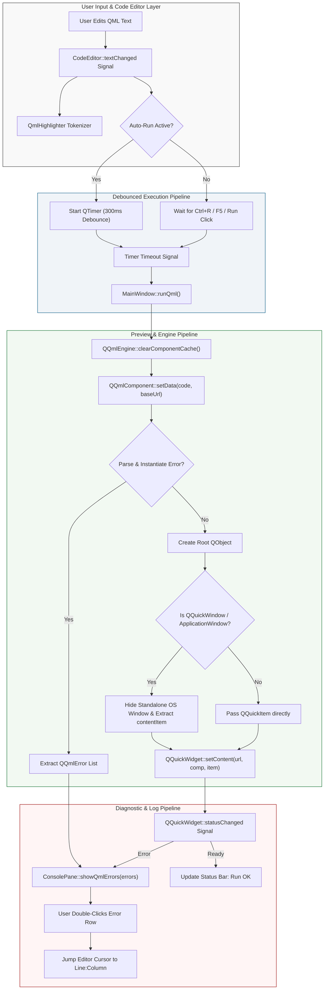
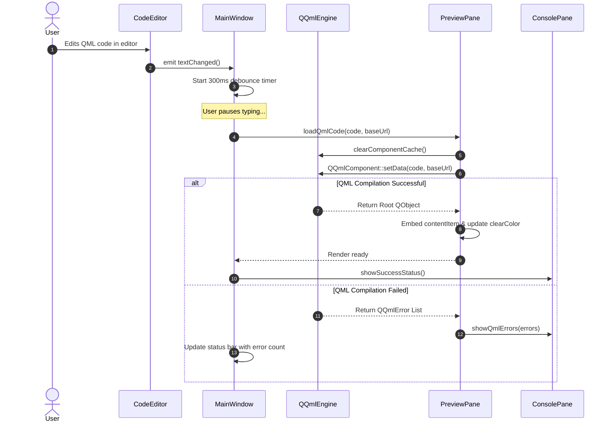
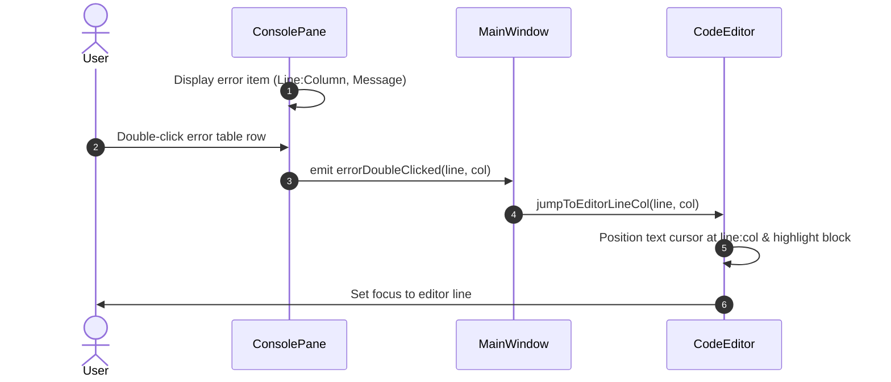

# QmlForge

Live QML Component Playground, Dynamic Component Runtime, and Real-Time Preview Engine in Qt 6 and C++17.

---

## Technical Abstract

QmlForge is an advanced Qt 6 desktop IDE and live rendering engine designed for real-time QML component development and playground testing. The system provides an integrated code editing environment coupled with a live QML preview pipeline:

1. **In-Process QQuickWidget Live Preview Pipeline**: Non-blocking asynchronous QML parsing, component cache invalidation (`QQmlEngine::clearComponentCache()`), and dynamic item rendering using `QQuickWidget` set to `SizeRootObjectToView`.
2. **Smart Window Embedding Architecture**: Intercepts top-level `QQuickWindow` and `ApplicationWindow` root objects, suppresses standalone OS window pop-ups (`win->hide()`), and reparents the window's root `contentItem` into the central preview pane.
3. **Real-Time Debounced Execution Engine**: Single-shot `QTimer` debouncing (300 ms) triggered by document modifications for immediate live updates without input blocking or UI stuttering.
4. **Diagnostic Error & Log Processing Pipeline**: Captures `QQmlComponent` / `QQuickWidget` error lists and intercepts global Qt log streams (`QtDebugMsg`, `QtWarningMsg`, `QtCriticalMsg`), providing interactive double-click line navigation to error locations.

---

## System Architecture

### Component Hierarchy

```text
+---------------------------------------------------------------------------------+
|                                APPLICATION MAIN                                 |
|                                   (main.cpp)                                    |
+----------------------------------------+----------------------------------------+
                                         |
                                         v
                            +--------------------------+
                            |        MainWindow        |
                            |  (QMainWindow / Splitter)|
                            +------------+-------------+
                                         |
          +------------------------------+------------------------------+
          |                              |                              |
          v                              v                              v
+-------------------+          +-------------------+          +-------------------+
|    CodeEditor     |          |    PreviewPane    |          |    ConsolePane    |
| (QPlainTextEdit)  |          |  (QQuickWidget)   |          |  (QTableWidget)   |
+---------+---------+          +---------+---------+          +---------+---------+
          |                              |                              |
          v                              v                              v
+-------------------+          +-------------------+          +-------------------+
|  QmlHighlighter   |          |  QQmlEngine /     |          | Qt Message Handler|
| (QSyntaxHighl...) |          |  QQmlComponent    |          | (Log & Error Stream)|
+-------------------+          +-------------------+          +-------------------+
```

### Data & Execution Pipeline Flow



---

## Communication Workflows

### 1. Live Code Execution & Preview Update Workflow



### 2. Error Diagnostic & Code Line Navigation Workflow



---

## Module Specifications

| Module | Base Class | Primary Responsibility |
| :--- | :--- | :--- |
| `MainWindow` | `QMainWindow` | Manages central splitters, toolbars, menus, status bar, and `QSettings` state persistence. |
| `CodeEditor` | `QPlainTextEdit` | Custom editor with monospace font, dynamic line number gutter, auto-indentation, and bracket matching. |
| `PreviewPane` | `QWidget` | Hosts `QQuickWidget`, handles component cache invalidation, and embeds `ApplicationWindow` content items. |
| `ConsolePane` | `QWidget` | Displays error tables and streaming Qt logs (`console.log`) with double-click line navigation. |
| `QmlHighlighter` | `QSyntaxHighlighter` | Tokenizer providing syntax coloring for QML keywords, types, strings, numbers, and properties. |

---

## Keyboard Shortcuts

| Action | Shortcut |
| :--- | :--- |
| **Run QML Code** | `Ctrl + R` / `F5` |
| **New File** | `Ctrl + N` |
| **Open File** | `Ctrl + O` |
| **Save File** | `Ctrl + S` |
| **Save As** | `Ctrl + Shift + S` |
| **Reset Font Size** | `Ctrl + 0` |
| **Zoom Font Size** | `Ctrl + Mouse Wheel` |
| **Undo / Redo** | `Ctrl + Z` / `Ctrl + Y` |

---

## System Requirements

- **Qt Framework**: Qt 6.5 or newer (Widgets, Qml, Quick, QuickWidgets)
- **C++ Compiler**: C++17 compliant compiler (MSVC 2019/2022, GCC 10+, or Clang 11+)
- **Build Tool**: CMake 3.16 or newer (`CMAKE_AUTOMOC` enabled)
- **Operating System**: Windows 10 / 11 (64-bit)

---

## Build Instructions

```powershell
# Configure CMake build
cmake -B build -G "Ninja" -DCMAKE_PREFIX_PATH="C:\Qt\6.8.3\mingw_64" -DCMAKE_BUILD_TYPE=Release

# Build application binary
cmake --build build --config Release
```

---

## Windows Deployment & Packaging

To generate a standalone distribution package including all required Qt Quick runtime modules and DLLs:

```powershell
powershell -ExecutionPolicy Bypass -File .\package.ps1
```

The resulting zip package is saved to:
```text
dist/QmlForge-v1.0.0-Windows-x64.zip
```

---

## Directory Structure

```text
QmlForge/
├── CMakeLists.txt         # Root CMake build configuration
├── main.cpp               # Application entry point & Qt message handler
├── MainWindow.h/.cpp      # Main window UI, splitters, toolbars, settings
├── CodeEditor.h/.cpp      # Line numbers, auto-indent, bracket matching
├── PreviewPane.h/.cpp     # QQuickWidget wrapper & window embedding
├── ConsolePane.h/.cpp     # Error table & console log stream
├── QmlHighlighter.h/.cpp  # QML syntax highlighter
├── resources.qrc          # Qt resource manifest for preset QML examples
├── QmlForge.rc            # Windows resource file
├── package.ps1            # Release build & deployment script
├── examples/              # Embedded QML examples
│   ├── rectangle.qml
│   ├── animation.qml
│   ├── listview.qml
│   ├── grid.qml
│   ├── button.qml
│   └── timer_state.qml
├── CHANGELOG.md           # Release history
├── LICENSE                # MIT License
└── README.md              # Project documentation
```

---

## License

This project is licensed under the [MIT License](LICENSE).

---

## Repository

- **GitHub Repository**: [https://github.com/ramanujaganesh26/QmlForge.git](https://github.com/ramanujaganesh26/QmlForge.git)
